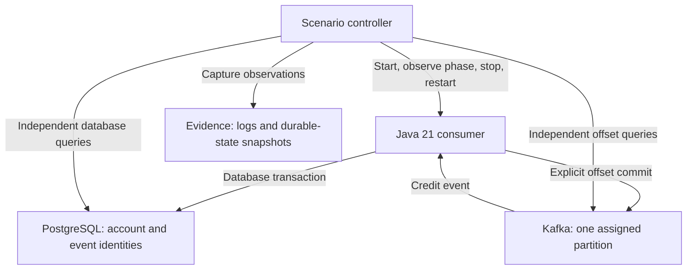

# Kafka Consumer Crash Lab

A reproducible Java 21, Kafka, and PostgreSQL lab exploring what happens when a consumer crashes between a database transaction and a Kafka offset commit.

**Technical article:** [When a Kafka Consumer Crashes After a Database Commit](https://www.jeshwin.com/articles/when-a-kafka-consumer-crashes-after-a-database-commit/)

**GitHub repository:** [Kafka Consumer Crash Lab](https://github.com/jeshwinwilliam/-kafka-consumer-crash-lab)

[Reproduction guide](docs/m5/reproduction.md) · [Results matrix](docs/m5/results-matrix.md) · [Evidence index](EVIDENCE-INDEX.md) · [v1.0.0 release](https://github.com/jeshwinwilliam/-kafka-consumer-crash-lab/releases/tag/v1.0.0)

## Why this lab exists

A consumer processes a record, updates PostgreSQL, and then crashes before committing its Kafka offset.

The database change survives. Kafka can deliver the record again. Without duplicate handling, the same business operation may run twice.

Reversing the commit order creates a different problem: the consumer can advance its offset before the database change is durable.

This lab makes both failure windows observable. It compares three processing strategies, deliberately stops the consumer at specific boundaries, and checks the database state and committed offsets after restart.

## What the lab compares

Each event credits an account by **100** units. The consumer reads from one manually assigned Kafka partition, with automatic offset commits disabled.

| Strategy | Order of work | Failure demonstrated |
| --- | --- | --- |
| Database first | Commit the credit, then commit the Kafka offset | A crash between commits allows replay to apply the credit again. |
| Offset first | Commit the Kafka offset, then commit the credit | A crash between commits advances consumption past a credit that was never applied. |
| Database deduplication | Insert the event identity and apply the credit in one PostgreSQL transaction, then commit the offset | Replay finds the retained identity and skips a matching credit that was already applied. |

The third strategy protects the database effect within the lab's assumptions. It does not prevent Kafka redelivery or place PostgreSQL and Kafka in a single transaction.

## Architecture

The controller starts a scenario and waits for a known execution phase before stopping the consumer. Separate database and offset queries establish what survived. A log message alone is not treated as proof of a commit.



In deduplication mode, the event key is `(handler_scope, event_id)`. Its insertion and the account update share one database transaction.

Matching duplicates skip the credit. Conflicting account or amount values are rejected. Deleting a retained identity removes that replay protection.

## What the recorded runs show

For the single-record fixture, committed offset **1** is the next position to consume after processing offset **0**.

| Scenario | Recorded outcome |
| --- | --- |
| No crash | Balance 100; committed offset 1. |
| Database-first crash after the database commit | Balance 100 before restart, then 200 after replay. |
| Offset-first crash after the offset commit | Balance remains 0; committed offset is already 1. |
| Deduplication crash after the database commit | Replay leaves balance at 100 with one retained event identity. |
| Deduplication crash before the database commit | The transaction rolls back; restart applies the credit once. |
| Two concurrent copies of the same event | The second transaction waits on the database conflict. Its eventual action depends on whether the first commits or rolls back. |
| Delete the deduplication key, then deliberately replay | The credit can be applied again. |

The retained evidence includes a **90-trial repeatability campaign**, seven separate frozen-source coverage runs, and 14 accepted fresh executions.

These are different evidence sets, not 111 different scenarios. The [results matrix](docs/m5/results-matrix.md) and [evidence guide](docs/m5/evidence-guide.md) explain the coverage and its limits.

## Requirements

- Docker with `docker compose`.
- Java **21** for compilation and execution. The recorded campaign used Homebrew OpenJDK **21.0.12.1**.
- Maven 3.9.x.
- Python 3 for the standard-library scenario controllers. The recorded campaign used Python **3.14.4**; this is not an asserted minimum supported version.
- Available local ports for the selected environment.

| Environment | Kafka | PostgreSQL |
| --- | --- | --- |
| Original | `localhost:9092` | `localhost:5433` |
| Isolated fresh reproduction | `localhost:19092` | `localhost:15433` |

The examples below use **Bash** and the original environment. For isolated fresh reproduction, follow the [reproduction guide](docs/m5/reproduction.md), including its endpoint and Compose-project settings.

### Select Java 21

On macOS with Homebrew:

```bash
set -euo pipefail

export JAVA_HOME="$(brew --prefix openjdk@21)/libexec/openjdk.jdk/Contents/Home"
export PATH="$JAVA_HOME/bin:$PATH"

java -version
javac -version
mvn -version
```

Check that `java` and `javac` identify Java 21 and that Maven reports running on Java 21.

Compiling with `--release 21` while executing on a newer JDK does not reproduce the recorded runtime.

On another platform, point `JAVA_HOME` to your Java 21 installation and make the same checks. The recorded campaign ran on macOS with Apple Silicon; those results do not establish behavior on other platforms.

## Set up the original environment

Run commands from the repository root. Inspect the Compose configuration and existing services first:

```bash
set -euo pipefail

docker compose -f compose.yaml config
docker compose -f compose.yaml ps
```

For a new lab environment, start the services:

```bash
set -euo pipefail

docker compose -f compose.yaml up -d --wait --wait-timeout 180
```

If you already have lab containers or data, inspect them before proceeding. `compose up` can recreate containers when their configuration has changed.

### Initialize a new database

The original Compose file does not mount initialization SQL. For a deliberately new database, apply the schema in order:

```bash
set -euo pipefail

docker compose -f compose.yaml exec -T postgres \
  psql -v ON_ERROR_STOP=1 -U crashlab -d crashlab \
  < sql/000_base_schema.sql

docker compose -f compose.yaml exec -T postgres \
  psql -v ON_ERROR_STOP=1 -U crashlab -d crashlab \
  < sql/001_processed_events_identity.sql
```

For an existing database, inspect its schema and data before applying either file.

### Build and test

With Java 21 selected and PostgreSQL initialized:

```bash
set -euo pipefail

mvn clean test dependency:copy-dependencies -DincludeScope=runtime
```

`DedupPostgresTest` opens a real database connection, so PostgreSQL and the schema must be ready before testing.

The frozen M4 evidence records four passing test methods. That provides regression coverage, not exhaustive correctness proof.

The controllers use this runtime classpath:

```text
target/classes:target/dependency/*
```

The commands below assume the original endpoints. Check any existing `CRASHLAB_KAFKA_BOOTSTRAP` and `CRASHLAB_JDBC_URL` overrides before running them.

## Run the scenarios

These controllers deliberately crash consumers and change lab state. Run scenarios sequentially in the intended environment and preserve their outputs.

```bash
set -euo pipefail

mkdir -p results

# No-crash baselines
python3 scripts/run_m2.py 1a  # Database first
python3 scripts/run_m2.py 1b  # Offset first
python3 scripts/run_m2.py 1c  # Database deduplication

# Crash-window scenarios
python3 scripts/run_m2.py 2   # Database first: after database commit
python3 scripts/run_m2.py 3   # Offset first: after offset commit
python3 scripts/run_m2.py 4   # Deduplication: after database commit
python3 scripts/run_m2.py 5   # Deduplication: before database commit
python3 scripts/run_m2.py 6   # Deduplication: after both commits

# Same event identity at two Kafka offsets
python3 scripts/run_m3_case7.py

# Missing account, distinct event IDs, and deduplication retention
python3 scripts/run_m3_remaining.py 10
python3 scripts/run_m3_remaining.py 11
python3 scripts/run_m3_remaining.py 12
```

Most controllers create a unique directory under `results/`. Check the captured state and verdict rather than relying only on the command finishing.

`run_m3_remaining.py` is a historical controller that hard-codes `compose.yaml`. Use it only with the original environment. Fresh replacements for cases 10–12 are documented in the [reproduction guide](docs/m5/reproduction.md).

### Capture a concurrency run

The direct concurrency harness writes NDJSON to stdout rather than creating its own evidence directory. Capture stdout, stderr, and the exit status explicitly:

```bash
set -euo pipefail

mkdir -p results
run_id="manual-case8-$(date -u +%Y%m%dT%H%M%SZ)-$$"

set +e
java -cp 'target/classes:target/dependency/*' \
  com.jeshwin.crashlab.M3ConcurrencyHarness commit "$run_id" \
  > "results/$run_id.stdout.ndjson" \
  2> "results/$run_id.stderr.log"
status=$?
set -e

printf '%s\n' "$status" > "results/$run_id.exit-status.txt"
```

For case 9, use `rollback` instead of `commit` and a new run ID. Keep failed or invalid outputs alongside successful ones.

## Evidence and reproduction

The public [v1.0.0 release](https://github.com/jeshwinwilliam/-kafka-consumer-crash-lab/releases/tag/v1.0.0) provides the source archive, public evidence derivative, and checksum files.

The repository also includes the public derivative at:

```text
evidence/public-derivatives/m4-public-evidence-derivative-20261118-r3.tar.gz
```

This is a separately identified, privacy-reviewed derivative of the retained evidence. Its checksums describe the public bytes. See [EVIDENCE-INDEX.md](EVIDENCE-INDEX.md) for the transformation record, validation report, and archive-relative mapping.

Some documents retained from release preparation describe the project as a local candidate or refer to pending publication. Those statements describe that preparation stage. The public release and article linked above are the publication references.

The v1.0.0 source and archives remain historical records. Later documentation corrections should be ordinary new commits rather than replacements of released assets.

| Document | What it covers |
| --- | --- |
| [Reproduction guide](docs/m5/reproduction.md) | Environment setup and original/fresh execution instructions. |
| [Commit boundaries](docs/m5/commit-boundaries.md) | Where each strategy commits database state and Kafka progress. |
| [Results matrix](docs/m5/results-matrix.md) | Scenario outcomes and coverage. |
| [Evidence guide](docs/m5/evidence-guide.md) | How to read the captured observations. |
| [Evidence index](EVIDENCE-INDEX.md) | Evidence provenance, public derivative, and checksums. |
| [Limitations](docs/m5/limitations.md) | Assumptions and guarantees the lab does not establish. |

## Limits of the demonstration

This lab focuses on consumer-process crashes around database and offset commits. It uses one manually assigned partition, serial processing, and a fixed credit amount.

It does not establish correctness during broker failures, database crashes, network partitions, consumer-group rebalances, or multi-partition processing. Bounded empty-poll observations do not prove that a record can never be delivered again. Repeatable results in this fixture are not statistical proof of general reliability.

Deduplication depends on stable event identities, retained keys, correct conflict handling, and keeping the identity insertion and business update in the same PostgreSQL transaction. It does not protect arbitrary external API calls or other effects outside that transaction.

This is an educational demonstration of established patterns, not a production framework or a claim of universal exactly-once processing.

## Author

Built and documented by **Jeshwin William James**.

- [Website](https://www.jeshwin.com/)
- [GitHub](https://github.com/jeshwinwilliam)

## License

Copyright (c) 2026 Jeshwin William James.

The code and accompanying repository documentation are available under the [MIT License](LICENSE). Third-party dependencies, container images, Kafka, and PostgreSQL retain their own licenses and notices.
